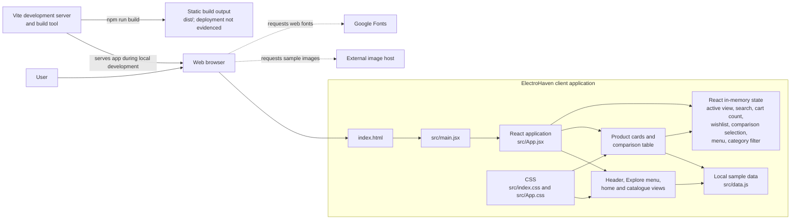
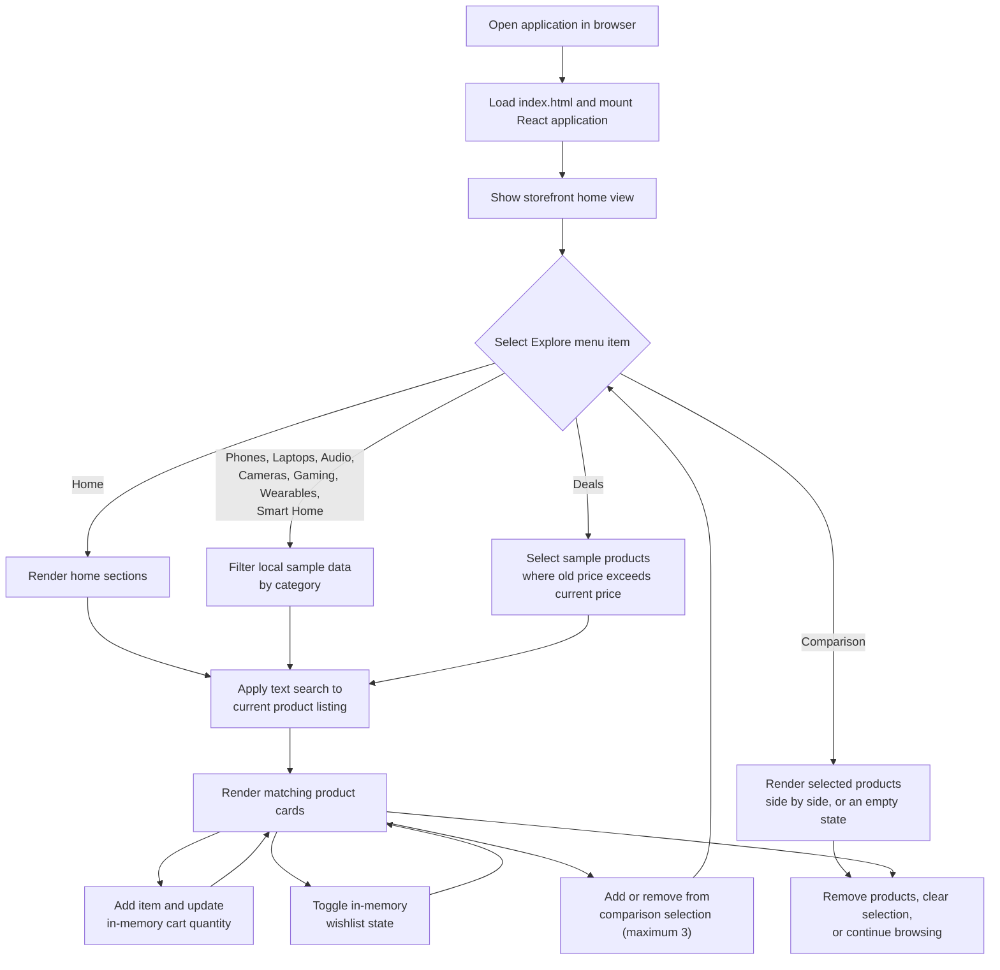
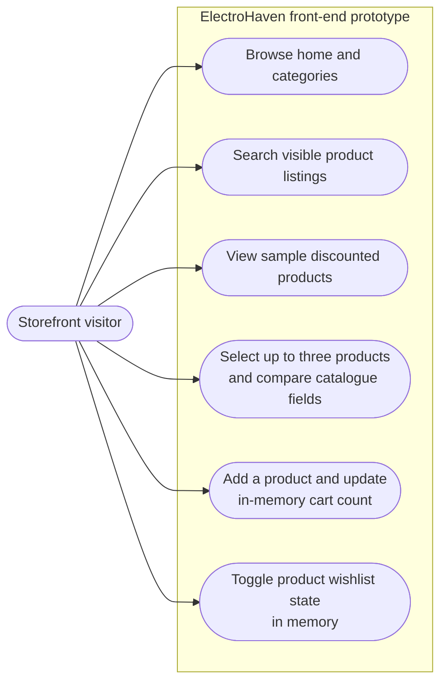

# PROJECT PROPOSAL

## 1. Title Page

### ElectroHaven: Electronics E-Commerce Product Discovery and Comparison Web Application

**Degree:** Bachelor of Technology  
**Department:** Computer Science and Engineering  
**Student name:** [STUDENT NAME]  
**Enrollment number:** [ENROLLMENT NUMBER]  
**University/college:** [UNIVERSITY NAME]  
**Project guide:** [GUIDE NAME]  
**Academic year:** 2026–2027

---

*[Suggested page break after the title page]*

## 2. Certificate Page Template

### CERTIFICATE

This is to certify that the project proposal entitled **“ElectroHaven: Electronics E-Commerce Product Discovery and Comparison Web Application”** is submitted by **[STUDENT NAME]**, Enrollment Number **[ENROLLMENT NUMBER]**, in partial fulfilment of the requirements for the degree of **Bachelor of Technology in Computer Science and Engineering** during the academic year **2026–2027**.

The proposal describes work carried out under my guidance. The project scope and implementation status stated in this document are based on the project files reviewed at the time of preparation.

|  |  |
|---|---|
| **Project guide** | **Head of Department** |
| Name: [GUIDE NAME] | Name: [HOD NAME] |
| Signature: ____________________ | Signature: ____________________ |
| Date: _________________________ | Date: _________________________ |

**Department seal**

---

*[Suggested page break after the certificate page]*

## 3. Student Declaration Template

### DECLARATION

I, **[STUDENT NAME]**, Enrollment Number **[ENROLLMENT NUMBER]**, declare that this project proposal entitled **“ElectroHaven: Electronics E-Commerce Product Discovery and Comparison Web Application”** has been prepared for my Bachelor of Technology project in Computer Science and Engineering. The description of the existing implementation is based on the source files available in my project workspace. Features identified as proposed or future work have not been represented as completed.

I will follow the academic integrity, authorship, and project-submission rules of **[UNIVERSITY NAME]**. Any external resources used in the project will be acknowledged in the final report.

**Student name:** [STUDENT NAME]  
**Enrollment number:** [ENROLLMENT NUMBER]  
**Signature:** ____________________  
**Place:** [PLACE]  
**Date:** _________________________

---

*[Suggested page break after the declaration page]*

## 4. Abstract

ElectroHaven is a browser-based electronics storefront prototype intended to help users browse products by category, search a small catalogue, identify discounted items, and compare up to three selected catalogue products side by side. The existing workspace contains a React user interface built with Vite, CSS styling, and a JavaScript file containing sample product and comparison data. The interface includes a home view, category views for phones, laptops, audio, cameras, gaming, wearables, and smart-home products, a deals view, and a comparison view. Product cards provide add-to-cart, wishlist, and comparison controls backed by in-memory application state.

The current implementation is a front-end prototype, not a complete transactional e-commerce service. No server-side application, database, user authentication, persistent cart, inventory service, order processing, or payment gateway was found in the reviewed files. The catalogue is fixed sample data, and product imagery and fonts are loaded from external services. Therefore, the system demonstrates product discovery and interface flows but does not complete or persist a purchase.

The proposed project will refine and evaluate this prototype as a product-discovery and comparison application. Further work may include requirements validation, improved filtering and comparison interactions, accessibility and responsive checks, systematic testing, and—if approved in the project scope—persistence or backend integration. The final feature set will be confirmed with the project guide. This proposal distinguishes the implemented baseline from planned work so that the project outcome remains technically accurate and achievable.

## 5. Keywords

ElectroHaven, e-commerce prototype, electronics catalogue, product discovery, product comparison, React, Vite, responsive web application.

## 6. Introduction

Online electronics catalogues can contain products with many specifications, including display size, processor, memory, storage, and price. Users may need to move between category listings and product details to understand how products differ. ElectroHaven explores a focused interface for browsing electronics and presenting selected specifications together.

The current application is a single-page React interface. It presents a storefront home view and uses the Explore menu to switch the visible content to category-specific product listings, a deals listing, or a comparison table. Product information is currently supplied by a local JavaScript data module rather than retrieved from a remote service. The prototype is intended to demonstrate the user interface and basic client-side interactions for an academic project.

## 7. Background and Motivation

Electronics products are commonly grouped into categories and described using different specifications. A clear catalogue can make it easier to locate relevant items, while a comparison view can make selected differences easier to review. The motivation for ElectroHaven is to bring these basic product-discovery tasks into one consistent interface.

The project also provides an opportunity to apply front-end engineering concepts in a concrete setting: reusable React components, state-driven rendering, product filtering, responsive CSS, and a build workflow. The current code provides a working starting point for further requirements-led development. It does not establish that users currently experience a measured problem or that the prototype improves purchasing outcomes; those claims would require user research and evaluation.

## 8. Problem Statement

Users exploring an electronics catalogue need a straightforward way to browse products by category, find products matching a text search, recognize items with displayed markdown prices, and review example product specifications side by side. The project workspace contains an early front-end storefront prototype, but its catalogue is small and static, and its cart and wishlist state is temporary. It does not provide backend data management or a completed purchase workflow.

The project problem is therefore to develop and evaluate a clear, responsive product-discovery and comparison interface using the existing prototype as a baseline, while accurately defining the limits of a front-end-only implementation.

## 9. Aim of the Project

To develop an academic web application prototype that organizes sample electronics products into browsable categories, supports basic search and deal discovery, and presents product specifications in a comparison view.

## 10. Specific Objectives

1. Review and document the existing ElectroHaven implementation and its limitations.
2. Present a consistent storefront home view and category-specific product listings.
3. Support text matching against product names and descriptions in the local catalogue.
4. Identify products with a displayed old price greater than their current sample price.
5. Present example laptop specifications in a readable comparison table.
6. Provide client-side add-to-cart quantity and wishlist-toggle interactions for product cards.
7. Maintain a responsive layout for common desktop and mobile viewport sizes.
8. Validate the application through build checks and a defined manual and automated test plan.
9. Keep proposed backend, persistence, authentication, and payment work separate from implemented front-end functionality unless those features are approved and completed in a later phase.

## 11. Existing System and Its Limitations

The reviewed project is an existing front-end prototype, not a surveyed external system. Its current behavior and limitations are as follows:

| Area | Current evidence in the workspace | Limitation |
|---|---|---|
| Product catalogue | Fifteen sample product objects in `src/data.js` | Fixed local data; no product administration or live catalogue service |
| Categories | Explore menu and category-specific views in `src/App.jsx` | Only the sample products in the source file are available |
| Search | Client-side matching against product names and descriptions | No server-side search, advanced filters, or relevance ranking |
| Deals | Listing selects products whose old price exceeds the current sample price | Markdown values are static examples, not time-bound or live promotions |
| Comparison | Visitors can select up to three catalogue products from product cards, inspect them side by side, remove individual selections, or clear the comparison | Selection is held in memory; the fields compare general catalogue data and do not provide detailed technical specifications for every product. The home page also retains a static example laptop table |
| Cart | Add-to-cart controls update quantities held in React state | No cart page, persistence, checkout, order, or stock validation |
| Wishlist | Product-card heart controls toggle in-memory state | State is not persisted; the header wishlist control is not connected to a wishlist page |
| User account | Header contains a sample account greeting | No authentication, customer profile, or account service |
| Data and services | No backend or database integration was found in the reviewed source | Data cannot be centrally updated or shared between users/devices |
| Product images and fonts | Image URLs and a Google Fonts import are present | Display depends on external network availability and third-party hosting |
| Testing | Package scripts provide development, build, and preview commands | No test or lint script or test files were identified in the inspected project files |

The repository also contains generated `dist` output and local Vite dependency metadata. These are build/runtime artifacts and are not evidence of a deployed production service.

## 12. Proposed System

The proposed system is an improved version of the existing ElectroHaven front end. It focuses on product discovery and comparison rather than claiming a complete online transaction service. A user can open the home view, select a product category, search the sample catalogue, review discounted examples, and compare up to three selected catalogue products. Product cards also expose client-side cart, wishlist, and comparison controls.

The current React/Vite structure and local data module provide the baseline. The comparison selection supports adding and removing products from product cards, viewing the current selection in the Explore menu, removing individual products, and clearing the selection. Planned refinements include verifying category coverage, reviewing responsive behavior, and adding repeatable tests. A backend, persistent database, customer account system, and payment workflow are outside the confirmed implementation and require explicit scope approval.

## 13. Scope of the Project

### Included in the current prototype

- A storefront home view with promotional, category, benefits, product, brand, comparison, and promotional sections.
- Explore menu views for phones, laptops, audio, cameras, gaming, wearables, smart home, and deals.
- A text search applied to the displayed local product name and description.
- Product cards with sample prices, old prices, ratings, descriptions, and remote image URLs.
- Deals listing based on the sample old-price/current-price relationship.
- A dynamic comparison view for up to three selected catalogue items and a separate static home-page laptop comparison example.
- In-memory cart quantity and wishlist-toggle demonstrations.
- Responsive styling for mobile and larger screens.

### Not included in the confirmed current scope

- Customer registration, sign-in, roles, or account management.
- Product or inventory administration.
- A backend API or database.
- Persistent cart or wishlist storage.
- Checkout, order placement, shipping calculation, refunds, or payment processing.
- Live inventory, live pricing, or real-time promotion management.
- A deployed public service or production operations setup.

The project guide and student should confirm whether any excluded capability is required for the final academic submission.

## 14. Target Users and Stakeholders

- **Primary users:** People browsing a sample electronics catalogue and comparing example product information.
- **Project student/developer:** Responsible for implementation, documentation, and evaluation.
- **Project guide:** Reviews scope, progress, technical decisions, and academic outcomes.
- **Department/university evaluators:** Assess the project against the approved academic requirements.
- **Potential future stakeholder:** A store administrator, if catalogue management or a backend is later approved. No administrator interface currently exists.

## 15. Functional Requirements

Requirements below describe the current baseline and realistic project expectations. “Implemented” means there is corresponding behavior in the reviewed source; it does not imply production readiness.

| ID | Requirement | Status |
|---|---|---|
| FR-01 | Display the ElectroHaven storefront home view. | Implemented |
| FR-02 | Allow the user to select a view from the Explore menu. | Implemented as client-side view selection |
| FR-03 | Display products for phones, laptops, audio, cameras, gaming, wearables, and smart home. | Implemented using local sample data |
| FR-04 | Display products with a sample markdown in the Deals view. | Implemented using a fixed price comparison |
| FR-05 | Filter the home product listing using category cards. | Implemented |
| FR-06 | Match the search text against product names and descriptions. | Implemented on the current displayed listings |
| FR-07 | Add a product to in-memory cart state and increment its quantity when added again. | Implemented; no cart interface or persistence |
| FR-08 | Toggle a product's wishlist state from its product card. | Implemented in memory; no wishlist page or persistence |
| FR-09 | Display the sample laptop specifications in a comparison table. | Implemented as a static home-page example |
| FR-10 | Select up to three catalogue products for side-by-side comparison, remove individual selections, or clear the selection. | Implemented in client-side in-memory state |
| FR-11 | Persist catalogue, cart, or wishlist data across sessions. | Not implemented; scope to be confirmed |
| FR-12 | Complete checkout and place an order. | Not implemented; outside confirmed scope |

## 16. Non-Functional Requirements

The following are project targets to validate, not claims that formal testing has already established them.

- **Usability:** Labels, category names, prices, and comparison headings should be understandable and consistent.
- **Responsive presentation:** Core content should remain usable on supported mobile and desktop viewport sizes.
- **Performance:** The interface should avoid unnecessary rendering and excessive asset weight for the intended academic demonstration. No measured performance target is available yet.
- **Reliability:** Search and category selection should produce predictable results for the available sample catalogue.
- **Maintainability:** Product data, UI components, and styles should remain organized in the existing source structure.
- **Accessibility:** Interactive elements should be keyboard operable, labelled, and readable with adequate contrast; this requires further audit and verification.
- **Compatibility:** The application should be checked in current mainstream browsers selected for evaluation.
- **Privacy:** The present prototype should not request real payment credentials or unnecessary personal data.
- **Security:** Any future server-side features must validate input and protect user and transaction data. No backend security assessment has been performed.

## 17. Main Modules and Their Responsibilities

| Module/component | Responsibility | Current implementation |
|---|---|---|
| `Header` | Brand link, search field, sample account and cart indicators, mobile menu control | In `src/App.jsx`; account and wishlist header controls are placeholders |
| `Sidebar` | Render Explore navigation and indicate the active view | In `src/App.jsx`; navigation updates React state |
| `Hero` | Present the home-view promotional message and calls to action | In `src/App.jsx` |
| `CategorySection` | Render category cards and set the home product filter | In `src/App.jsx` |
| `ProductSection` | Filter and display the home-view product cards | In `src/App.jsx` |
| `CatalogPage` | Render a category- or deals-specific catalogue view | In `src/App.jsx` |
| `ProductCard` | Display sample product details and expose add-to-cart, wishlist, and add/remove comparison controls | In `src/App.jsx` |
| `Compare` | Display the selected catalogue products in a dynamic comparison page and a separate static laptop example on the home page | In `src/App.jsx`; selected products come from local catalogue data |
| `Brands`, `Benefits`, `Promos`, `Footer` | Render supplementary storefront content | In `src/App.jsx` |
| Product data | Store navigation, category, product, and comparison examples | `src/data.js` |
| Styling | Set global and application layout, colors, components, and responsive rules | `src/index.css` and `src/App.css` |
| Application entry | Mount the React application into the HTML root | `src/main.jsx` |

## 18. Technology Stack and Justification

| Technology | Evidence/version in project | Purpose and justification |
|---|---|---|
| JavaScript with JSX | Source files use `.js` and `.jsx` | Implements application behavior and declarative React UI |
| React | `react` and `react-dom` declared as `^18.3.1` | Component model and state-driven rendering suit reusable catalogue and product-card views |
| Vite | `vite` declared as `^5.4.8`; `dev`, `build`, and `preview` scripts are present | Provides a development server and a production build workflow for the front end |
| `@vitejs/plugin-react` | Declared as `^4.3.1` | Enables React support in the Vite toolchain |
| HTML | `index.html` contains the root element and module entry | Provides the browser document into which React mounts |
| CSS | `src/index.css` and `src/App.css` | Styles the application and its responsive layouts without an additional UI framework |
| npm | `package.json` and `package-lock.json` are present | Declares dependencies and records dependency resolution |
| Google Fonts | External import in `src/index.css` | Loads DM Sans and Space Grotesk for the current interface |
| Unsplash image URLs | Product image URLs in `src/data.js` | Supplies sample remote product imagery; image availability depends on the external service |

No database, backend framework, API client, authentication library, or payment library is declared in the reviewed package manifest. No additional UI component library is listed.

## 19. System Architecture

The current architecture is a client-side single-page application:

The Vite development server supplies the application during local development, and the Vite build command creates static build output. Vite is not an application backend. The reviewed source contains no server-side API, database, or deployment configuration. Product images and fonts are requested from external services by the browser.

## 20. System Workflow

The following diagram describes the implemented client-side flow. Cart and wishlist changes remain in memory; they are not saved to a server.

1. The browser loads `index.html`, which imports the React entry point.
2. `src/main.jsx` mounts the `App` component into the root HTML element.
3. The application initializes its client-side state and reads the sample catalogue imported from `src/data.js`.
4. The user selects a section from the Explore menu. React state determines whether the home, category/deals, or comparison view is displayed.
5. For a catalogue view, the application selects products by the page category or, for Deals, by comparing the sample old and current prices.
6. Search text is matched against product names and descriptions in the relevant listing.
7. Product-card controls update cart quantity and wishlist state in memory and can add or remove a product from the comparison selection, which is limited to three items.
8. The Comparison view displays selected catalogue products side by side; the user can remove individual products or clear the selection. If no products are selected, the view prompts the user to choose products from a catalogue.

No order is sent to a server, and no cart, wishlist, or user information is saved by a backend in the current implementation.

### Use-Case Diagram

This diagram represents only visitor interactions supported by the current front end. It does not show an administrator, account system, checkout, or payment service because none was found in the reviewed implementation.

## 21. Database Design and Main Entities, if Applicable

### Current status

Database design is **not applicable to the current implementation** because no database or server-side persistence was found. Product and comparison records are JavaScript objects in `src/data.js`. Cart and wishlist state is held in React state and is not persisted.

An ER diagram is therefore not included: drawing one as if it described the existing system would imply a database that is not present. The conceptual entities below are a possible future design only and are not implemented.

### Possible future data model (not implemented)

If persistence is approved, a conceptual model could include:

| Entity | Possible attributes | Purpose |
|---|---|---|
| Product | Product ID, name, description, category ID, current price, old price, rating, image reference | Store catalogue items |
| Category | Category ID, name, description | Group products for browsing |
| User | User ID and authentication-related fields defined with appropriate security controls | Identify an account only if accounts are approved |
| Cart item | Cart ID or user ID, product ID, quantity | Represent a user's selected products |
| Wishlist item | User ID, product ID | Represent saved products for an authenticated user |
| Comparison specification | Product ID, specification name, specification value | Store comparable product attributes |

This is a planning model only. It is not a description of existing tables, a selected database schema, or an implementation commitment. Database selection and data retention requirements are to be confirmed if backend work enters scope.

## 22. Security, Privacy, and Data Protection Considerations

- The reviewed application does not implement user accounts, server-side data storage, or payment processing.
- Cart quantities, wishlist selections, and comparison selections are held in browser application state. They should not be treated as durable or private user records.
- The prototype should use sample data for demonstrations and should not solicit real passwords, payment-card details, or unnecessary personal information.
- Product image requests and font loading contact external services. The final deployment should document these dependencies and consider self-hosted or approved assets if privacy, availability, or institutional policy requires it.
- Any future backend must use HTTPS in deployment, validate data on the server, apply appropriate access controls, protect secrets outside source control, and minimize stored personal data.
- Payment handling, if ever approved, should use a suitably assessed payment provider rather than storing payment credentials in the application.
- Accessibility and security checks remain project work; this proposal does not certify the current prototype as secure or compliant.

## 23. Feasibility Study

### Technical feasibility

The current interface uses widely adopted front-end technologies listed in its package manifest. The existing components and local data provide a feasible base for refining the catalogue, search, and comparison experience. A backend or database would introduce new design, implementation, and testing work and should only be included after guide approval.

### Economic feasibility

The current development stack consists of open-source packages, and the application can be developed locally using a compatible computer and browser. No hosting, domain, paid API, or payment-provider costs are evidenced in the current project. Any future hosting or third-party service cost is to be confirmed before adoption.

### Operational feasibility

The prototype is operated through a browser and has a Vite development command. Its category navigation and card interactions are intended for a general user audience. A public operational service is not evidenced; deployment, catalogue maintenance, customer support, and operations are therefore outside the present baseline.

## 24. Software and Hardware Requirements

### Software

- A supported desktop operating system (the current development workspace is Windows).
- Node.js and npm versions compatible with the installed Vite/React dependencies; exact required versions are **to be confirmed** because no engine constraints are declared in `package.json`.
- Visual Studio Code or another source editor.
- A current web browser for running and evaluating the interface.
- Git for source version control, as the workspace is a Git repository.
- Network access when using the current externally hosted fonts and product images.

### Hardware

No project-specific hardware specification is recorded. A general-purpose laptop or desktop capable of running Node.js, a source editor, and a modern browser is expected to be sufficient for front-end development. Minimum memory, processor, and storage requirements are **to be confirmed** based on the institution's environment.

## 25. Development Methodology

An iterative, incremental methodology is proposed:

1. **Requirements and baseline review:** Confirm the academic scope, user scenarios, and implemented behavior.
2. **Interface and data design:** Review page structure, category mapping, product fields, and comparison attributes.
3. **Incremental implementation:** Refine catalogue views, search and comparison behaviors in small, reviewable changes.
4. **Verification:** Test expected interactions and responsive layouts as features are completed.
5. **Evaluation and documentation:** Record limitations, test evidence, guide feedback, and final results.

The current repository is a starting implementation; this proposal does not claim that a formal methodology or evaluation has already been completed.

## 26. Project Implementation Plan

1. Confirm project title, user scenarios, requirements, and the boundary between prototype and complete commerce functions.
2. Review and normalize the sample product catalogue and category assignments.
3. Refine category, search, deals, comparison, and empty-result experiences.
4. Review cart and wishlist interactions and make their demo-only behavior clear.
5. Improve responsive behavior, keyboard operation, labels, and visual accessibility.
6. Add appropriate component or browser-level tests if approved and supported by the final project scope.
7. Execute build and manual checks; record browser, viewport, and observed results.
8. Prepare the final report, demonstration, and guide-approved deliverables.

Backend, database, authentication, and payment work are conditional extensions, not assumed tasks in this plan.

## 27. Testing Strategy

No dedicated test files or test scripts were identified in the inspected project configuration. Testing is therefore a proposed activity rather than a claim of completed test coverage.

| Test level | Proposed checks |
|---|---|
| Build check | Run the existing `npm run build` command and resolve compilation/build errors |
| Functional/manual | Verify menu selection, category filtering, search matching, deals selection, cart quantity updates, wishlist toggles, comparison selection, the three-product limit, individual removal, clearing all selections, and the empty state |
| Data checks | Confirm each navigation category maps to the intended sample products and that Deals excludes products without a markdown |
| UI/responsive | Inspect representative desktop and mobile widths for overflow, readable content, and usable controls |
| Accessibility | Keyboard-test interactive controls; inspect labels, focus visibility, heading structure, image alternatives, and color contrast |
| Browser compatibility | Test in the browsers selected with the project guide and record versions and observations |
| Regression | Recheck the home view and shared product-card behavior after catalogue or navigation changes |

Automated unit or end-to-end testing technology is **to be confirmed**. Test outcomes must be recorded only after tests are actually run.

## 28. Expected Outcomes and Deliverables

- A documented, browser-based ElectroHaven product-discovery prototype.
- Category-specific product listings and a deals listing based on the local sample data.
- Search, product-card, cart-state, and wishlist-state interactions.
- A comparison view that compares up to three selected catalogue products, plus a static laptop comparison example on the home page.
- Source code and dependency/build configuration.
- A test plan and evidence of the checks actually completed.
- Final project report and academic demonstration, subject to institutional requirements.

An operational e-commerce platform, production deployment, database, or payment facility is not an expected deliverable unless approved and implemented as additional scope.

## 29. Project Timeline in a Week-Wise Table

The following is an indicative 16-week plan. The project start date, institutional milestones, and guide review dates are **to be confirmed**.

| Week | Planned activity | Expected checkpoint |
|---:|---|---|
| 1 | Confirm title, problem, users, and academic scope | Approved project brief |
| 2 | Inspect baseline code and prepare requirements | Requirements and status register |
| 3 | Review page flows, catalogue fields, and comparison needs | UI/data design |
| 4 | Refine shared layout and navigation behavior | Reviewed navigation |
| 5 | Refine category views and product mapping | Category catalogue checks |
| 6 | Refine search and no-results behavior | Search scenarios |
| 7 | Review deals logic and price presentation | Deals scenarios |
| 8 | Refine comparison view and clarify comparison controls | Comparison review |
| 9 | Review cart and wishlist demonstration behavior | State-interaction checks |
| 10 | Improve mobile and desktop responsiveness | Responsive review |
| 11 | Review accessibility and usability issues | Accessibility findings |
| 12 | Add/execute agreed automated and manual tests | Test records |
| 13 | Regression testing and issue resolution | Stable project build |
| 14 | Prepare final technical report and diagrams | Draft documentation |
| 15 | Guide review, corrections, and demonstration preparation | Approved final draft |
| 16 | Final demonstration and submission | Project submission |

If a backend is added to the approved scope, this timeline should be revised to include data modeling, API implementation, security review, and additional integration testing.

## 30. Current Implementation Status

Status below reflects inspection of the workspace source files while preparing this proposal. “Implemented” describes code presence and visible client-side behavior, not independent production validation.

| Feature | Status | Evidence/qualification |
|---|---|---|
| React application entry and Vite scripts | Implemented | `src/main.jsx`, `package.json` |
| Home storefront sections | Implemented | `src/App.jsx` |
| Explore menu view selection | Implemented | `navItems` in `src/data.js`; view selection in `src/App.jsx` |
| Category catalogue views | Implemented with sample data | `catalogPages` and `CatalogPage` in `src/App.jsx`; product objects in `src/data.js` |
| Deals view | Implemented as a static price filter | Selects records where `oldPrice > price`; no live promotion source |
| Search | Implemented client-side | Matches product name and description |
| Product cards and sample prices/ratings | Implemented | `ProductCard` and `products` data |
| Cart quantity state | Partially implemented | In-memory state and header count; no cart page or checkout |
| Wishlist toggle | Partially implemented | In-memory product-card toggle; no persistence or wishlist page |
| Product comparison | Implemented in memory | Select up to three catalogue products, remove individual products, and clear the selection; a static example laptop table remains on the home page |
| Backend, API, database, authentication | Not found in reviewed project files | No such service or dependency is declared |
| Checkout or payment | Not found in reviewed project files | No transaction workflow is implemented |
| Automated test suite | Not found in inspected files/configuration | No test script or test files were identified |
| Deployment configuration | Not found in inspected project files | Build output alone does not establish deployment |

The package manifest declares `dev`, `build`, and `preview` scripts. No test or lint script is declared there. Additional requirements or files outside the inspected workspace would need separate confirmation.

## 31. Limitations and Risks

- The product catalogue and comparison specifications are small, hard-coded examples and may not represent real products.
- Sample discounts, prices, ratings, and review counts are not connected to a live source and must not be treated as current commercial information.
- Cart and wishlist state is temporary and can be lost when the application reloads.
- The comparison selection is temporary and resets when the application reloads. Generic catalogue fields are compared; detailed technical specifications are not available consistently for every product.
- There is no implemented order, inventory, customer account, or payment workflow.
- External image and font availability depends on network access and third-party services.
- The absence of a configured test suite means regression and accessibility quality have not been established by automated evidence.
- The institutional acceptance criteria, exact submission format, final feature scope, and required hardware/software versions remain to be confirmed.
- Extending the prototype into a real commerce service would add substantial data, security, privacy, operational, and testing responsibilities.

## 32. Future Enhancements

Subject to guide approval and project time:

1. Persist comparison, cart, and wishlist selections using an approved storage design.
2. Add sorting and filters such as price range and product attributes.
3. Add detailed, category-appropriate technical specifications to the comparison experience.
4. Introduce a backend API and database for centrally managed catalogue data.
5. Add authenticated user accounts only if needed, with secure credential handling.
6. Add a cart page and a simulated academic checkout workflow; a real payment workflow would need separate approval and security review.
7. Replace or supplement external sample images with approved, reliable assets.
8. Add automated unit and browser-level tests and a repeatable accessibility review.
9. Add product administration, stock management, and live promotions only if backend scope is approved.
10. Deploy the application to an approved hosting environment and document configuration and operational constraints.

## 33. Conclusion

ElectroHaven is currently a React/Vite front-end prototype for browsing a sample electronics catalogue, searching products, viewing markdown examples, and comparing up to three selected products using general catalogue fields. It also demonstrates limited in-memory cart and wishlist interactions and retains a static laptop comparison example on the home page. The project does not currently provide server-side data, persistence, customer authentication, checkout, payment, or deployment evidence.

The proposed work is to refine and evaluate this product-discovery and comparison experience while preserving an accurate boundary between the current prototype and future capabilities. This scope is suitable for incremental development as a BTech CSE project, subject to confirmation of institutional requirements and approval by the project guide.

## 34. References

1. React Documentation, **“Quick Start”** and official React documentation, https://react.dev/learn. Access date: [ACCESS DATE].
2. Vite Documentation, **“Getting Started”**, https://vite.dev/guide/. Access date: [ACCESS DATE].
3. MDN Web Docs, **“JavaScript”**, https://developer.mozilla.org/en-US/docs/Web/JavaScript. Access date: [ACCESS DATE].
4. MDN Web Docs, **“CSS”**, https://developer.mozilla.org/en-US/docs/Web/CSS. Access date: [ACCESS DATE].
5. MDN Web Docs, **“HTML”**, https://developer.mozilla.org/en-US/docs/Web/HTML. Access date: [ACCESS DATE].
6. Project source files reviewed for this proposal: `package.json`, `package-lock.json`, `index.html`, `src/main.jsx`, `src/App.jsx`, `src/data.js`, `src/index.css`, and `src/App.css`.

Access dates for web references should be completed by the student when the sources are consulted for the final submission. No research papers, test results, API services, or database systems are claimed as project evidence in this proposal.

## 35. Project Guide Approval and Signature Section

### Approval

I have reviewed the proposed scope and understand that the current implementation is a front-end prototype. Any change to include backend, database, authentication, deployment, or payment functions will be agreed separately.

**Project guide name:** [GUIDE NAME]  
**Comments/conditions:**  
____________________________________________________________________________  
____________________________________________________________________________  
____________________________________________________________________________

**Project guide signature:** ______________________________  
**Date:** ____________________

**Student signature:** ____________________________________  
**Date:** ____________________
